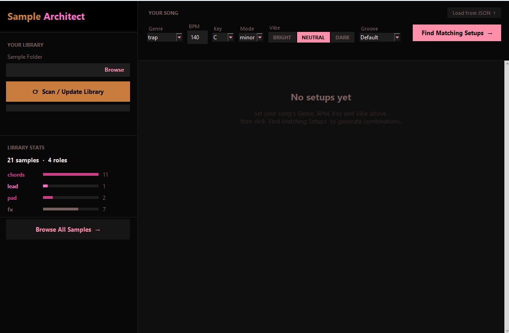

# Sample Architect

An audio sample library manager and intelligent setup generator for music producers. Point it at your sample folder, let it analyze your library, then describe your track — Sample Architect finds combinations of samples that work together musically.



## Features

- **Automatic library analysis** — scans your folders for `.wav`, `.aiff`, `.flac`, `.mp3`, and `.ogg` files, then extracts BPM, key, mode, and timbral characteristics using librosa
- **Smart sample classification** — assigns each sample a musical role (chords, lead, pad, fx, kick, bass, etc.) based on audio features
- **Setup generation** — given a genre, BPM, key, and vibe, generates complete multi-sample setups using harmonic compatibility and timbral matching
- **Persistent library** — stores all analysis results in a local SQLite database so rescans are fast

## Requirements

- Python 3.10+

## Installation

```bash
git clone https://github.com/JulianWIAI/sample_architect.git
cd sample_architect
python -m venv .venv
.venv\Scripts\activate      # Windows
# source .venv/bin/activate  # macOS / Linux
pip install -r requirements.txt
```

## Usage

```bash
python main.py
```

1. Click **Browse** and select your samples folder
2. Click **Scan / Update Library** — analysis runs in the background
3. Set your song's **Genre**, **BPM**, **Key**, **Mode**, **Vibe**, and **Groove**
4. Click **Find Matching Setups** to generate combinations
5. Use **Browse All Samples →** to explore your full library by role

## Project Structure

```
sample_architect/
├── main.py                   # entry point
├── src/
│   ├── analysis/
│   │   ├── audio_analyser.py # feature extraction (BPM, key, timbre)
│   │   └── library_scanner.py
│   ├── matching/
│   │   ├── setup_generator.py # setup composition engine
│   │   └── scorer.py          # weighted compatibility scoring
│   ├── data/
│   │   ├── database.py
│   │   └── schema.sql
│   └── gui/
│       ├── app.py
│       ├── library_panel.py
│       ├── setup_browser.py
│       ├── sample_cell.py
│       └── styles.py
└── requirements.txt
```

## Data

The library database is stored at `~/.sample_architect/library.db`. Delete it to reset the library.
